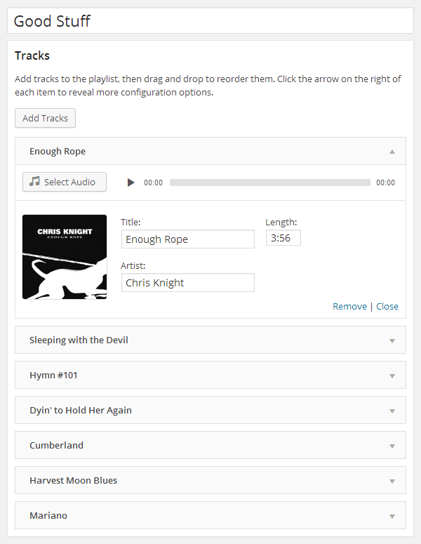

# Cue

Delightful and reliable audio playlists.

__Contributors:__ [Brady Vercher](https://twitter.com/bradyvercher), [Brody Vercher](https://twitter.com/brover), [Luke McDonald](https://twitter.com/thelukemcdonald)  
__Requires:__ WordPress 5.6+  
__License:__ [GPL-2.0+](https://www.gnu.org/licenses/gpl-2.0.html)

*Cue* makes it easy to create and manage beautiful, fully responsive audio playlists. Primarily built with music in mind, *Cue* can also be used for podcasts, sermons or to showcase voice over samples.

There's no need to fiddle with XML, JSON, or FTP. Just upload audio files with the familiar WordPress Media Manager, then insert them into a playlist with the click of a button. *Cue* fetches metadata from uploaded files to automatically complete the title, artist, and length for each track.

It works on desktop, tablets, and other mobile devices.


## Features

* Create unlimited playlists.
* Embed a player in any post, page, or sidebar using a shortcode or widget.
* Reorder tracks with a simple drag and drop interface.
* Seamlessly integrates with WordPress’ media manager to select audio and images.
* Automatically fetches title, artist, and length from the metadata if it's available.
* Completely responsive to work on any device that supports your audio format.
* Link to external sources like Amazon S3 or other CDNs.
* Customize the player background image.
* Use custom artwork for each track.

  
_The interface to add, edit and rearrange a playlist's tracks._

  
_The rendered player on the front end._


## Installation

[*Cue* is in the WordPress.org plugin directory](https://wordpress.org/plugins/cue/) and can be installed from your admin panel.


## Development

Requires Node.js 22+ and [pnpm](https://pnpm.io/) (run `corepack enable` to use the pinned version).

```bash
pnpm install
pnpm run build
```

`pnpm run package` builds a release zip in `dist/`.


## Releasing

Pushing a tag deploys the plugin to WordPress.org with the [deploy workflow](.github/workflows/push-deploy.yml). It checks the version, builds the package, commits it to SVN trunk and a new tag, updates the directory assets in `.wordpress-org`, and creates a GitHub release with the zip.

1. Update `version` in `package.json` and add a `### x.y.z - Month D, YYYY` changelog entry to `readme.txt`.
2. Run `pnpm run package`. It copies the version to `cue.php` (the `Version` header and the `CUE_VERSION` constant used to version scripts and styles) and the `Stable tag` in `readme.txt`, and builds a zip in `dist/` you can test.
3. Commit, then tag and push:

   ```bash
   git tag x.y.z
   git push origin develop x.y.z
   ```

4. After the deploy workflow finishes, merge the release into the `trunk` branch.

To try a release without deploying, run the workflow from the Actions tab. Manual runs build everything but don't commit to SVN.

Pushing the `trunk` branch updates `readme.txt` and the directory assets on WordPress.org without a release, for changes like bumping "Tested up to".

Both workflows need the `SVN_USERNAME` and `SVN_PASSWORD` repository secrets.
